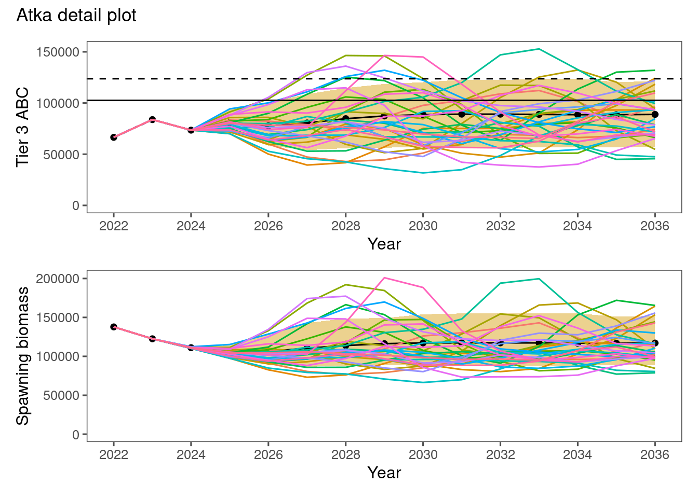
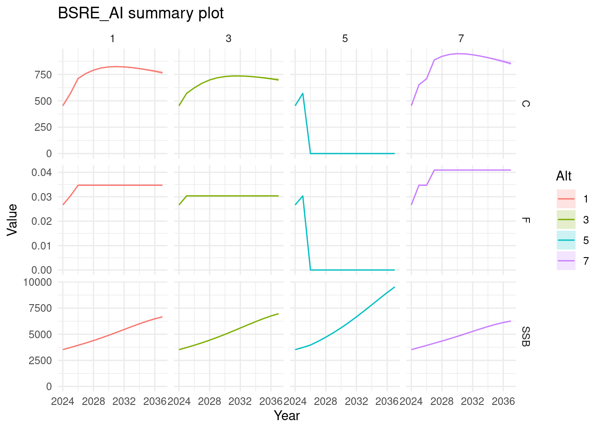

# spmR canonical examples

``` r

if (file.exists(file.path("..", "DESCRIPTION"))) {
  pkgload::load_all("..", export_all = FALSE, helpers = FALSE, quiet = TRUE)
} else {
  library(spmR)
}
library(readr)
```

This vignette provides three canonical workflows from the [source
repository](https://github.com/afsc-assessments/spmR):

- `examples/atka` for
  [`runSPM()`](https://afsc-assessments.github.io/spmR/reference/runSPM.md),
  [`dat2list()`](https://afsc-assessments.github.io/spmR/reference/dat2list.md),
  and
  [`plotSPMx()`](https://afsc-assessments.github.io/spmR/reference/plotSPMx.md)
- `examples/BSRE_AI` for
  [`plotSPM()`](https://afsc-assessments.github.io/spmR/reference/plotSPM.md)
  with `spm_summary.csv`
- `examples/gt_2026` for auditing and staging new split-sex inputs

The bundled positional files retain their historical layout. For a new
run, use
[`write_spm_metadata()`](https://afsc-assessments.github.io/spmR/reference/write_spm_metadata.md)
to embed explicit recruitment basis and female/male population weights
as comments in each species file, then use a format-2 executable. Follow
the runnable [split-sex input migration
guide](https://afsc-assessments.github.io/spmR/articles/split_sex_inputs.md).
Keep each species file’s existing field order and store added population
vectors in the versioned comment block. The current native engine reads
that block directly; separate JSON and native sidecar files remain
supported for existing workflows.

The first two workflows read archived output. The third identifies
missing scientific declarations and incomplete histories before a new
projection.

## 1. Atka workflow (`examples/atka`)

Use
[`runSPM()`](https://afsc-assessments.github.io/spmR/reference/runSPM.md)
to read existing ADMB output (`spm_detail.csv`) and inspect inputs using
[`dat2list()`](https://afsc-assessments.github.io/spmR/reference/dat2list.md).

``` r

pkg_root <- if (file.exists("DESCRIPTION")) "." else ".."
atka_dir <- file.path(pkg_root, "examples", "atka")

atka_detail <- runSPM(atka_dir, run = FALSE, engine = "admb")
str(atka_detail)
#> spm_rslt [105,000 × 20] (S3: spm_result/spec_tbl_df/tbl_df/tbl/data.frame)
#>  $ Stock      : chr [1:105000] "Model_16.0b" "Model_16.0b" "Model_16.0b" "Model_16.0b" ...
#>  $ Alt        : num [1:105000] 1 1 1 1 1 1 1 1 1 1 ...
#>  $ Sim        : num [1:105000] 1 1 1 1 1 1 1 1 1 1 ...
#>  $ Year       : num [1:105000] 2022 2023 2024 2025 2026 ...
#>  $ SSB        : num [1:105000] 137805 122551 111309 106528 107685 ...
#>  $ Rec        : num [1:105000] 648 518 358 529 1080 ...
#>  $ Tot_biom   : num [1:105000] 631455 619958 620871 620648 586312 ...
#>  $ SPR_Implied: num [1:105000] 0.517 0.444 0.455 0.413 0.41 ...
#>  $ F          : num [1:105000] 0.372 0.504 0.482 0.576 0.583 ...
#>  $ Ntot       : num [1:105000] 551 514 473 473 483 ...
#>  $ Catch      : num [1:105000] 66481 83800 73495 83297 82317 ...
#>  $ ABC        : num [1:105000] 102578 98592 86706 83297 82317 ...
#>  $ OFL        : num [1:105000] 123759 118791 101474 97783 96860 ...
#>  $ AvgAge     : num [1:105000] 4.73 4.52 4.22 4.06 4.19 ...
#>  $ AvgAgeTot  : num [1:105000] 2.81 2.79 2.97 2.81 2.28 ...
#>  $ SexRatio   : num [1:105000] 0.5 0.5 0.5 0.5 0.5 0.5 0.5 0.5 0.5 0.5 ...
#>  $ B100       : num [1:105000] 280456 280456 280456 280456 280456 ...
#>  $ B40        : num [1:105000] 112182 112182 112182 112182 112182 ...
#>  $ B35        : num [1:105000] 98160 98160 98160 98160 98160 ...
#>  $ Scenario   : chr [1:105000] "1" "1" "1" "1" ...
#>  - attr(*, "spec")=
#>   .. cols(
#>   ..   Stock = col_character(),
#>   ..   Alt = col_double(),
#>   ..   Sim = col_double(),
#>   ..   Year = col_double(),
#>   ..   SSB = col_double(),
#>   ..   Rec = col_double(),
#>   ..   Tot_biom = col_double(),
#>   ..   SPR_Implied = col_double(),
#>   ..   F = col_double(),
#>   ..   Ntot = col_double(),
#>   ..   Catch = col_double(),
#>   ..   ABC = col_double(),
#>   ..   OFL = col_double(),
#>   ..   AvgAge = col_double(),
#>   ..   AvgAgeTot = col_double(),
#>   ..   SexRatio = col_double(),
#>   ..   B100 = col_double(),
#>   ..   B40 = col_double(),
#>   ..   B35 = col_double()
#>   .. )
#>  - attr(*, "problems")=<pointer: 0x557667e63560>

atka_inputs <- dat2list(file.path(atka_dir, "spm.dat"))
names(atka_inputs)
#>  [1] "rn"               "Tier"             "nalts"            "alts"            
#>  [5] "tac_flag"         "srr_type"         "srr_form"         "srr_conditioning"
#>  [9] "srr_reserved"     "spm_detail_flag"  "nprj_yrs"         "nsims"           
#> [13] "beg_yr"           "nyrs_fixed_catch" "nspp"             "OY_min"          
#> [17] "OY_max"           "datafile"         "ABC_mults"        "scalars"         
#> [21] "alt4_spr"         "nTAC_cat"         "nTACind"          "fixed_catch"
```

Plot detailed simulation trajectories with
[`plotSPMx()`](https://afsc-assessments.github.io/spmR/reference/plotSPMx.md).

``` r

plotSPMx(atka_detail, alt = 2, thisyr = min(atka_detail$Year), mytitle = "Atka detail plot")
```

[](https://afsc-assessments.github.io/spmR/articles/spm_example_files/figure-html/atka-plot-1.png)

Archived experimental RTMB output can also be read from this directory.
New RTMB projections are blocked because the prototype lacks population
dynamics. New ADMB projections require
[`write_spm_metadata()`](https://afsc-assessments.github.io/spmR/reference/write_spm_metadata.md)
and a format-2 executable.

``` r

runSPM(atka_dir, run = FALSE, engine = "rtmb")
```

## 2. Summary workflow (`examples/BSRE_AI`)

[`plotSPM()`](https://afsc-assessments.github.io/spmR/reference/plotSPM.md)
expects summary-format data (`spm_summary.csv`).

``` r

bsre_dir <- file.path(pkg_root, "examples", "BSRE_AI")
bsre_summary <- read_csv(file.path(bsre_dir, "spm_summary.csv"))
plotSPM(bsre_summary, alt = c(1, 3, 5, 7), mytitle = "BSRE_AI summary plot")
```

[](https://afsc-assessments.github.io/spmR/articles/spm_example_files/figure-html/bsre-summary-1.png)

## 3. Audit and stage Greenland turbot (`examples/gt_2026`)

The revised 2026 export has 47 recruitment values and 45 SSB values. Its
helper reports the mismatch and stops before staging until matching
source histories are supplied. Population weights, units, ages, and SS3
export-field definitions also require review. The [GT2026 audit and
staging
guide](https://afsc-assessments.github.io/spmR/articles/gt2026_inputs.md)
explains each finding.

``` r

gt2026_dir <- file.path(pkg_root, "examples", "gt_2026")
source(file.path(gt2026_dir, "run.R"), local = TRUE)
gt::gt(check_gt2026_inputs(gt2026_dir))
```

| item | status | detail |
|----|----|----|
| Native metadata | info | A separate spm_input_v2.dat is optional; the runner embeds validated declarations in the staged species file. |
| R metadata | info | A separate spm_metadata.json is optional. Existing files are archived; staged declarations come from explicit arguments or diagnostic defaults. |
| Recruitment rows | repair | 2 copies of a 47 value series across 4 lines; retain one complete series. A second copy would be read as SSB. |
| Recruitment basis | ok | Source explicitly declares per_sex recruitment. |
| Spawning weights | repair | 4 zeros in effective spawning weights; stage them as 1e-12 for the current positive-weight contract. |
| Population weights | missing | Population body weights require explicit runner arguments and SS3 verification. Diagnostic defaults use Fratio-weighted catch-weight proxies, with fleet fractions 0.96, 0.04 |
| Units and ages | review | Thousand fish, kg, tonnes and ages 1:30/30+ are working assumptions requiring SS3 export verification. |
| SSB history | missing | 47 recruitment values but 45 SSB values. Supply matching source histories before staging; values are never padded or discarded. |
| Maturity fields | info | All-one maturity retains effective spawning weights. Ntot and SexRatio describe all fish and the all-fish female fraction. Confirm the SS3 spawning-weight definition. |
| Controls | ok | 2026-2040; 7 alternatives; 1000 simulations. Adapter requires Tier 3, Rec_Gen=1, TAC_ABC=1, beginning year 2026 and ForProjections.dat. |
| TAC parameters | info | tacpar.dat is archived when supplied and unused with TAC_ABC=1. |

The next chunk displays the expected staging block and verifies that no
attempt directory is created. `run = FALSE` leaves native execution
disabled.

``` r

gt2026_attempt <- tempfile("spmr-gt2026-canonical-")
gt2026_status <- tryCatch(
  run_gt2026_projection(
    source_dir = gt2026_dir,
    run_dir = gt2026_attempt,
    run = FALSE
  ),
  error = function(condition) {
    detail <- conditionMessage(condition)
    if (!grepl("47 recruitment values but 45 SSB values", detail, fixed = TRUE)) {
      stop(condition)
    }
    detail
  }
)
stopifnot(is.character(gt2026_status), !dir.exists(gt2026_attempt))
cat("Staging blocked:", gt2026_status)
#> Staging blocked: 47 recruitment values but 45 SSB values. Supply matching source histories before staging; values are never padded or discarded.
```

After supplying matching source histories, diagnostic mode explicitly
selects fishery-weight proxies for population body weights, thousand
fish, kg, tonnes, and ages 1–30 with a terminal plus group. These
assumptions require review. The following future commands are displayed
without execution:

``` r

source("examples/gt_2026/run.R")
staged <- run_gt2026_projection(diagnostic = TRUE, run = FALSE)
gt2026 <- run_gt2026_projection(diagnostic = TRUE)
gt2026$summary
```

The helper compiles the self-contained template using `admb` on `PATH`
or `SPMR_ADMB`; `SPMR_EXECUTABLE` selects an existing compatible
executable. Review the complete input evaluation in
`examples/gt_2026/README.md` before interpreting results.
